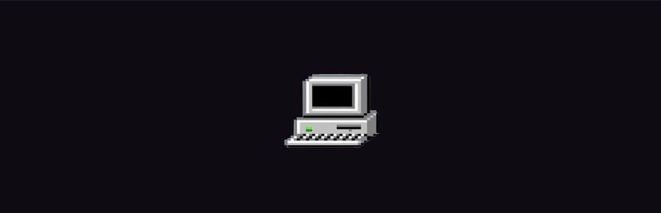

<p align="center">
  <!-- Твой личный загруженный баннер -->
  
</p>

##  About Me

```json
{
  "name": "Dizotec",
  "role": "AMCS Student, ML Enthusiast",
  "location": "Moscow",
  "working_on": [
    "Разработка проектов на IT-хакатонах",
    "Решение алгоритмических задач и олимпиадное программирование"
  ],
  "learning": [
    "Machine Learning & Deep Learning (ML/DL)",
    "Архитектура нейронных сетей"
  ],
  "tech_stack": {
    "languages": ["C/C++", "Python"],
    "ml_libraries": ["NumPy", "Scikit-Learn", "PyTorch"]
  }
}
```

> *"Простота — залог надежности." — Эдсгер В. Дейкстра*

---

## 🔗 Connect With Me

* 🌐 **ВКонтакте:** <a href="https://vk.ru/afs_ai13" target="_blank">://vk.com</a>
* 📱 **Telegram:** <a href="https://t.me/dizilnyiotec" target="_blank">@dizotec</a>
* ✉️ **Почта Mail.ru:** <a href="rqwzxn@mail.ru">rqwzxn@mail.ru</a>

---

## 🛠️ Tech Stack

* 💻 **Languages & Frameworks:**
  `C/C++` &nbsp;&bull;&nbsp; `Python` &nbsp;&bull;

* 🧰 **Tools & Databases:**
  `Git` &nbsp;&bull;&nbsp; `VS Code` &nbsp;&bull;  &nbsp;&bull;&nbsp; `Docker`


