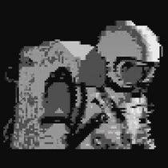

<p align="center">
  <!-- Твой личный загруженный баннер -->
  
</p>
<!-- Вшитый монохромный космонавт (работает автономно без скачивания файлов) -->
<style>.p{fill:%238b949e;}.w{fill:%23ffffff;}</style><rect width='160' height='315' fill='%230d1117'/><path class='p' d='M40,90 h80 v10 h-80 z M30,100 h100 v10 h-100 z M20,110 h120 v80 h-120 z M30,190 h100 v10 h-100 z M40,200 h80 v10 h-80 z'/><path class='w' d='M45,120 h70 v50 h-70 z'/><path class='p' d='M55,130 h50 v30 h-50 z'/><circle cx='80' cy='150' r='5' class='w'/><path class='w' d='M40,220 h25 v40 h-25 z M95,220 h25 v40 h-25 z M45,260 h20 v30 h-20 z M95,260 h20 v30 h-20 z'/></svg>" align="left" height="315" style="margin-right: 25px; margin-bottom: 10px;" alt="Astronaut" />

```json
{
  "name": "Dizotec",
  "role": "AMCS Student, ML Enthusiast",
  "location": "Moscow",
  "working_on": [
    "Разработка проектов на IT-хакатонах",
    "Решение алгоритмических задач и олимпиадное программирование"
  ],
  "learning": [
    "Machine Learning & Deep Learning (ML/DL)",
    "Архитектура нейронных сетей"
  ],
  "tech_stack": {
    "languages": ["C/C++", "Python"],
    "ml_libraries": ["NumPy", "Scikit-Learn", "PyTorch"]
  }
}
```

> *"Простота — залог надежности." — Эдсгер В. Дейкстра*

---

## 🔗 Connect With Me

* 🌐 **ВКонтакте:** <a href="https://vk.ru" target="_blank">://vk.com</a>
* 📱 **Telegram:** <a href="https://t.me" target="_blank">@dizilnyiotec</a>
* ✉️ **Почта Mail.ru:** <a href="mailto:rqwzxn@mail.ru">rqwzxn@mail.ru</a>

---

## 🛠️ Tech Stack

* 💻 **Languages & Frameworks:**  
  `C/C++` &bull; `Python`

* 🧰 **Tools & Databases:**  
  `Git` &bull; `VS Code` &bull; `Docker`
Используйте код с осторожностью.
Жми Commit changes. Этот вариант полностью независим, не выдаст ни 403, ни 404 ошибки и сразу отобразит силуэт космонавта слева от твоего красивого JSON-блока.

##  About Me

```json
{
  "name": "Dizotec",
  "role": "AMCS Student, ML Enthusiast",
  "location": "Moscow",
  "working_on": [
    "Разработка проектов на IT-хакатонах",
    "Решение алгоритмических задач и олимпиадное программирование"
  ],
  "learning": [
    "Machine Learning & Deep Learning (ML/DL)",
    "Архитектура нейронных сетей"
  ],
  "tech_stack": {
    "languages": ["C/C++", "Python"],
    "ml_libraries": ["NumPy", "Scikit-Learn", "PyTorch"]
  }
}
```

> *"Простота — залог надежности." — Эдсгер В. Дейкстра*

---

## 🔗 Connect With Me

* 🌐 **ВКонтакте:** <a href="https://vk.ru/afs_ai13" target="_blank">://vk.com</a>
* 📱 **Telegram:** <a href="https://t.me/dizilnyiotec" target="_blank">@dizotec</a>
* ✉️ **Почта Mail.ru:** <a href="rqwzxn@mail.ru">rqwzxn@mail.ru</a>

---

## 🛠️ Tech Stack

* 💻 **Languages & Frameworks:**  
  `C/C++` &bull; `Python`

* 🧰 **Tools & Databases:**  
  `Git` &bull; `VS Code` &bull; `Docker`


